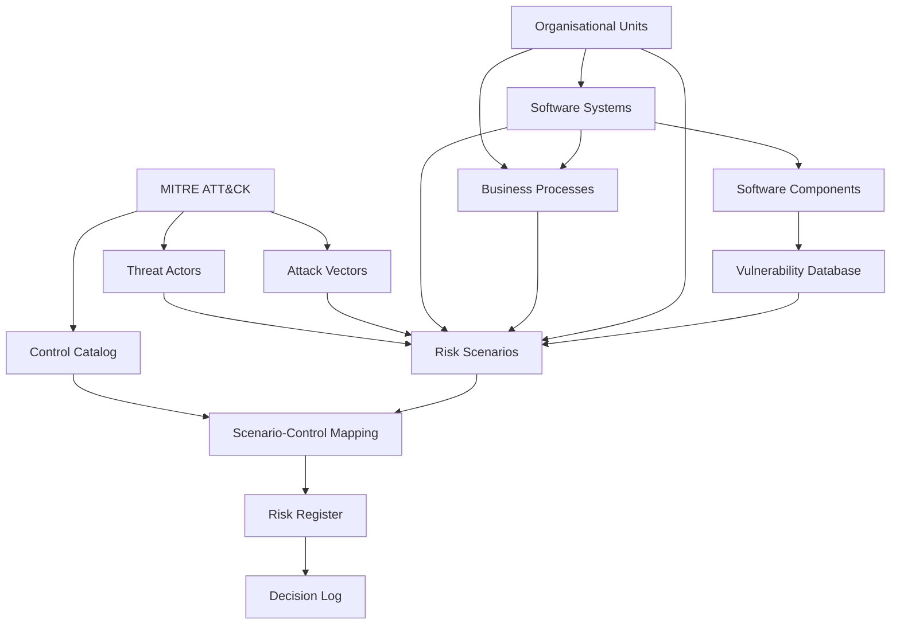
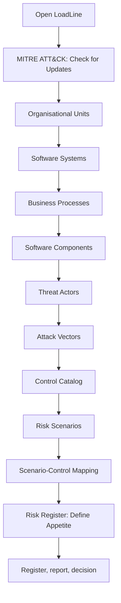
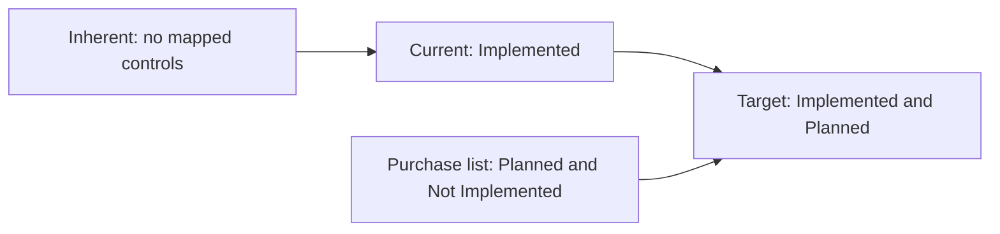
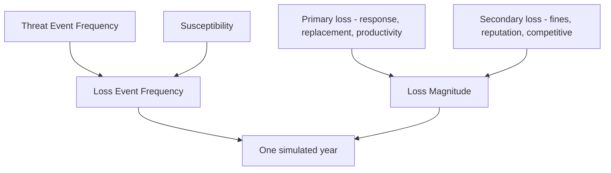

# LoadLine User Guide

LoadLine is a cyber risk quantification workspace. You describe the organisation, the systems it depends on, the threats you care about, and the controls you already have or might buy. LoadLine then estimates annual loss for each scenario and for the portfolio, compares that loss with the board’s appetite, and keeps a sealed record of the decision.

The estimates follow FAIR in plain terms: how often a threat actor tries something, how often that attempt succeeds, and how much a successful event costs. Expert judgment is stored as a minimum, a most likely value, and a maximum. A simulation turns those three numbers into a spread of possible years.

This guide is the operating manual. It tells you, screen by screen, what to enter, what LoadLine does with it, and what to check before you move on. It does not explain how the application is built.

## Contents

1. [Open the application](#open-the-application)
2. [Key terms](#key-terms)
3. [Where to do what](#where-to-do-what)
4. [How the screens fit together](#how-the-screens-fit-together)
5. [Load the demo, in order](#load-the-demo-in-order)
6. [How an upload behaves](#how-an-upload-behaves)
7. [Inventory](#inventory)
8. [Intelligence](#intelligence)
9. [Risk scenarios](#risk-scenarios)
10. [Controls](#controls)
11. [Risk Register](#risk-register)
12. [Decision Log](#decision-log)
13. [Settings](#settings)
14. [Risk Simulation](#risk-simulation)
15. [A short reading of the loss](#a-short-reading-of-the-loss)
16. [Habits that keep the catalog honest](#habits-that-keep-the-catalog-honest)
17. [Troubleshooting](#troubleshooting)

## Open the application

LoadLine runs in a web browser. Start it from the project folder with `docker compose up -d --build`, then open http://localhost:8080.

The browser tab title stays **LoadLine** on every screen. The page heading is the name of the screen you are on. The Home mark in the corner returns to the start page. The menu button lists every screen, in this order:

- **Inventory:** Organisational Units, Software Systems, Software Components, Business Processes.
- **Intelligence:** MITRE ATT&CK, Vulnerability Database, Threat Actors, Attack Vectors.
- **Risk Analysis:** Risk Scenarios, Control Catalog, Scenario-Control Mapping, Risk Register, Decision Log, Risk Simulation.
- **Settings**, last.

The first MITRE download and the vulnerability scan need outbound internet. Catalog uploads do not.

## Key terms

| Term | Meaning in LoadLine |
|---|---|
| Scenario | One threat actor, one attack vector, and one target. It is the unit that is costed. |
| Worksheet | The numbers saved on a scenario. Loss is calculated from the worksheet and nothing else. |
| Three-point estimate | A minimum, a most likely value (the mode), and a maximum. |
| TEF | Threat-event frequency: how many times a year the actor attempts the vector. |
| Susceptibility | The share of attempts that become loss events, from 0 to 1. |
| Loss event | One attempt that succeeds. Its yearly count cannot exceed the scenario’s cap. |
| Primary loss | Response, replacement, and productivity loss. It occurs on every loss event. |
| Secondary loss | Fines, reputation, and competitive loss. It occurs on an event only with the secondary-loss probability. |
| Lambda | A number from 1 to 10 that pulls a three-point estimate toward its mode. Higher means closer to the mode. |
| Inherent, Current, Target | The three loss views: no controls, Implemented controls, and Implemented plus Planned controls. |
| ALE | Annual loss expectancy: the mean annual loss. |
| VaR95 | The annual loss exceeded in one simulated year out of twenty. |
| TVaR95 | The average loss across the simulated years at or above VaR95. |
| Appetite | The limits the board sets for loss, budget, and approval. |
| RTO | Recovery time objective: the hours a process may be down before the recovery target is missed. |
| FTE | Full-time equivalent: the number of full-time staff who are occupied by a process. |
| CVSS, EPSS, KEV | Vulnerability severity score, exploit-prediction score, and CISA’s list of vulnerabilities known to be exploited. |
| PURL | Package URL: the standard identifier of a software package. |
| BCR, ROSI | Benefit-cost ratio and return on security investment of a control. |

## Where to do what

| I want to… | Go to |
|---|---|
| Describe teams, systems, and processes | Inventory |
| Register the packages a system runs and see their weaknesses | Software Components, Vulnerability Database |
| Look up an ATT&CK technique, group, or mitigation | MITRE ATT&CK |
| Define who attacks and how | Threat Actors, Attack Vectors |
| Cost a scenario | Risk Scenarios |
| Record a safeguard and attach it to a scenario | Control Catalog, Scenario-Control Mapping |
| Compare loss with the board’s limits and pick investments | Risk Register |
| Issue and approve a board pack | Risk Register, then Decision Log |
| Change the figures Suggest uses | Settings |
| Explore a three-point estimate on its own | Risk Simulation |

## How the screens fit together



Work through the catalogs in that direction. A later screen names IDs from an earlier one. LoadLine rejects a row whose ID does not exist yet, and it saves nothing from a file that contains such a row.

Inventory is the organisation. Intelligence is the threat and vulnerability evidence. Risk Analysis is where you commit numbers, apply controls, compare the result with appetite, and record a decision. Settings holds the benchmark table that **Suggest** reads. Risk Simulation is a sandbox for one frequency triple and one magnitude triple. It does not read the catalogs.

Large amounts are shown with a thousands separator, such as `8,000,000`. Money on the risk screens uses the currency mark `¤`. Edit boxes keep the raw number you typed. A blank catalog number is stored as **Unknown**. LoadLine leaves that cell empty. It does not write zero in its place. Scenario worksheets are the exception: every numeric cell on a scenario is required.

## Load the demo, in order

The files in `demo/` are a small bank-style catalog. Upload them in the order below. Each later file names IDs from an earlier one, so a file uploaded too early is rejected and nothing from that file is saved.

Load MITRE before the threat and control files. Attack vectors always cite a technique chain, and those IDs are checked against the Enterprise dataset. Control mitigations and actor group IDs are checked the same way when you fill them in.



| Step | Screen | What you do | Demo file |
|---|---|---|---|
| 1 | MITRE ATT&CK | Press **Check for Updates** and wait until the dataset is loaded | Downloaded from MITRE. There is no file in `demo/`. |
| 2 | Organisational Units | Upload | `demo/demo_data_organisational_units.csv` |
| 3 | Software Systems | Upload | `demo/demo_data_systems_inventory.xlsx` |
| 4 | Business Processes | Upload | `demo/demo_data_business_processes.xlsx` |
| 5 | Software Components | Upload. A vulnerability scan starts when the file is accepted | `demo/demo_data_software_components.xlsx` |
| 6 | Threat Actors | Upload | `demo/demo_data_threat_actors.csv` |
| 7 | Attack Vectors | Upload | `demo/demo_data_attack_vectors.xlsx` |
| 8 | Control Catalog | Upload | `demo/demo_data_controls.xlsx` |
| 9 | Risk Scenarios | Upload | `demo/demo_data_risk_scenarios.xlsx` |
| 10 | Scenario-Control Mapping | Upload | `demo/demo_data_scenario_controls.csv` |
| 11 | Risk Register | Press **Define Appetite** and type the figures below | `demo/demo_risk_appetite.csv` is a reference. It is not an upload. |

The demo appetite to type is:

| Field | Value |
|---|---|
| Statement | Keep annual cyber loss inside the board limit. |
| ALE Appetite | 2000000 |
| VaR95 Appetite | 4000000 |
| Scenario ALE Tolerance | 500000 |
| Annual Treatment Budget | 180000 |
| Approval Threshold | 100000 |
| Amortisation Years | 3 |
| Updated By | Chief Risk Officer |

After that, open **Risk Scenarios**. The Inherent, Current, and Target columns fill with simulated mean annual loss. Open **Risk Register** for the portfolio, the appetite test, and the treatment ranking. **Generate Board report** stores a pack you can approve or reject on **Decision Log**.

## How an upload behaves

Every catalog screen works the same way.

1. The drop zone explains the columns. Press **Upload file**, or drag a `.csv` or `.xlsx` onto the panel.
2. Column names can appear in any order. A missing required column rejects the whole file before any row is checked.
3. LoadLine checks every row before it writes anything. If one cell is wrong, the review table highlights it and the previous catalog stays as it was. Correct the file and upload it again. A successful file replaces the whole catalog for that screen.
4. After a successful upload, the table appears. **Export Catalog** downloads what is stored. **Upload New Catalog** replaces the whole catalog. On Scenario-Control Mapping that button reads **Upload New Mapping**. **+** adds one row. The pencil edits a row. The trash can deletes a row.
5. You cannot delete or rename an ID that another catalog still points at. A replacement file has to keep those IDs, or the upload is rejected and the previous catalog stays.
6. Click a column title to sort. Use the filter row to search text or to pick an allowed value such as High or Implemented. Amounts in the tables use thousands separators. The pager sits under the table when the list is long.

The header shows when the catalog was last replaced or edited. That time is the catalog’s own clock. It is not the time of a simulation.

## Inventory

Inventory answers who owns the work, which systems carry it, which packages those systems run, and which processes stop when a system stops. Suggest and the data-gap list read these fields. A field you leave blank stays Unknown and is named later, on the scenario that needs it.

### Organisational Units

This is the list of teams. Each unit has an ID such as `OU-01`, a name, what it is responsible for, who oversees it, a headcount, and a loaded hourly cost.

| Column | What you enter | Where it is used |
|---|---|---|
| OU ID | A stable ID. Other screens store this ID, so keep it once other catalogs point at it. | Owner of systems, processes, scenarios, and controls. |
| Organisational Unit | The team name. | Shown beside the ID. |
| Primary Responsibilities | Free text. | Record only. |
| Oversight | Free text, such as the executive who oversees the unit. | Record only. |
| Headcount | Number of people, or blank. | Productivity suggestions. Also a data gap when blank. |
| Loaded Hourly Cost | Cost of one loaded hour, or blank. | Productivity suggestions. Also a data gap when blank. |

Headcount and hourly cost feed the productivity proposal on a scenario. If either is blank, Suggest withholds productivity and names the missing field. The form keeps whatever productivity numbers are already there.

A process cannot claim more full-time equivalents than the unit’s headcount, once that headcount is known and greater than zero.

### Software Systems

Each system has a business owner unit and a technical custodian unit. Both IDs must already exist on Organisational Units.

| Column | Allowed values | Where it is used |
|---|---|---|
| System ID | Stable ID, such as `SYS-01`. | Target of a scenario, primary system of a process, home of a component. |
| System | Name. | Shown in the table. Hover the name to read the primary function. |
| Business Owner OU ID | An existing unit. | Recorded with the system. The technical custodian is shown underneath the business owner. |
| Technical Custodian OU ID | An existing unit. | Record only. The loss formulas do not read the custodian. |
| Criticality | Low, Medium, or High. | Recorded on the system. Process criticality is what caps availability and integrity suggestions. |
| Data Classification | Public, Internal, or Confidential. | Suggest uses the highest classification among the systems a scenario touches when it prices confidentiality response, fines, and secondary-loss probability. |
| Deployment | Local, Cloud, or Hybrid. | Recorded and shown. It does not change the simulation. |
| Internet Facing | Yes, No, or blank. | A blank is stored as Unknown. Suggest withholds threat-event frequency when a vector requires internet exposure and any affected system is Unknown. A system that is not internet facing scales that frequency down. |
| Replacement Cost | Money, or blank. | Suggest prices replacement from the sum of these costs. A blank is a data gap. |
| Records Held | Count, or blank. | Suggest prices fines from this count when the data is Confidential. A blank is a data gap. |

### Business Processes

A process belongs to one unit and lists the systems it depends on. Put several system IDs in the Primary System IDs cell, separated by commas. Every system ID must already exist. Criticality is Low, Medium, or High.

| Column | What you enter | Where it is used |
|---|---|---|
| Process ID | Stable ID, such as `BP-01`. | Target of a scenario, or a process linked through a system. |
| Organisational Unit ID | An existing unit. | Headcount and hourly cost for productivity. |
| Primary System IDs | One or more system IDs. | The systems whose loss the process shares, and the processes a system scenario affects. |
| Criticality | Low, Medium, or High. | The highest criticality among linked processes sets the availability and integrity event cap, and the reputation band. |
| Recovery Time Objective | Hours, or blank. | Outage length in an availability suggestion. A blank is a data gap. |
| Downtime Cost per Hour before RTO | Money per hour before the recovery objective, or blank. | Outage cost. A blank is a data gap. |
| Downtime Cost per Hour after RTO | Money per hour after the recovery objective, or blank. | A blank uses the before-objective cost. It is not a data gap. |
| FTE Count | People occupied by the process. | Productivity. It cannot exceed the unit’s headcount when that headcount is known and greater than zero. A blank is a data gap. |

On the edit form, the two downtime costs sit on one row. The sentence **Blank uses the before-objective cost.** sits under the post-RTO field.

A process with no systems, or a system that no process lists, is reported later as a data gap on every scenario that touches it.

### Software Components

A component is a package on a system: a Component ID, a System ID that already exists, and a Package URL (PURL).

Uploading a new inventory replaces the previous components and clears old vulnerability findings. When the file is accepted, LoadLine scans the packages. Open **Vulnerability Database** to see the result. If the feeds were unreachable, the inventory is still saved and the status explains the scan. Press **Scan for Vulnerabilities** when the network is available.

A system with no components is a data gap. Findings change suggestions only. They do not rewrite a scenario you have already saved.

## Intelligence

Intelligence is the evidence Suggest reads, and the ATT&CK IDs you cite so a reviewer can see which technique, group, or mitigation you had in mind. Those IDs document the row. They do not scale frequency or loss by themselves.

### MITRE ATT&CK

Press **Check for Updates**. LoadLine downloads the current Enterprise ATT&CK dataset from MITRE. If that version is already loaded, it tells you so. The header shows the ATT&CK version and when it was loaded.

Browse tactics, techniques, groups, software, mitigations, campaigns, and the other object types. Search by ID or name. Open a row for the description and references. **Show deprecated** includes deprecated objects.

You do not upload this dataset from a spreadsheet. Actors, vectors, and controls cite its IDs, and those IDs are checked when you save or upload those catalogs. A blank group list or a blank mitigation list is allowed. A technique chain is required on every vector. Revoked and deprecated IDs are accepted when the ID is still in the dataset.

Load this dataset before you upload threat actors, attack vectors, or controls. A file that cites an ID from an empty dataset is rejected.

### Vulnerability Database

This table is the result of the component scan. Each row is a finding on a package: the CVE, the CVSS score when one was published, the EPSS score, whether the CVE is in CISA’s Known Exploited Vulnerabilities list, and when the record was modified.

**Scan for Vulnerabilities** runs the scan again against the current component inventory. The scan asks OSV, NVD, FIRST EPSS, and the CISA KEV feed. Suggest uses the findings when it proposes susceptibility:

- No findings on the affected systems uses the “no findings” evidence factor.
- An EPSS of 0.1 or more, or a KEV flag, uses the exploited factor. That evidence is chosen ahead of CVSS.
- Otherwise the highest CVSS decides: below 7, 7 or higher, or unknown when every score is blank.
- A vector that does not require an exploitable vulnerability uses a factor of 1 and ignores the findings.

A saved worksheet stays as you left it. Run Suggest again and press **Save** when you want the worksheet to follow a new scan.

If the KEV feed has never been reached, that missing feed is itself a data gap on the register.

### Threat Actors

An actor is who might cause the loss. One scenario names one actor.

| Column | Allowed values | Where it is used |
|---|---|---|
| Actor ID | Stable ID. | Named by a scenario. |
| Threat Actor | Name. | Shown beside the ID. |
| Actor Type | Cybercrime, Nation-State, Hacktivist, Insider, Supply Chain, or Opportunistic. | Insider, together with a confidentiality loss, brings competitive loss into the suggestion. |
| Motivation | Financial, Espionage, Disruption, Ideological, or Grievance. | Espionage, together with a confidentiality loss, brings competitive loss into the suggestion. |
| Capability | Low, Medium, or High. | Stored with the actor. It does not enter the loss formula. |
| Sector Targeting | Low, Medium, or High. | Scales the suggested threat-event frequency by the matching Settings factor. |
| ATT&CK Group IDs | Optional, for example `G0032`. Several IDs are separated by commas. | Checked against the loaded dataset. They do not change the numbers. |
| Description and Reference | Free text. | Record only. |

### Attack Vectors

A vector is how the loss happens. One scenario names one vector.

| Column | What you enter | Where it is used |
|---|---|---|
| Vector ID | Stable ID. | Named by a scenario. |
| Attack Vector | Name. | Shown beside the ID. |
| ATT&CK Technique Chain | A path of technique IDs joined by `->`, for example `T1190 -> T1059 -> T1486`. Commas or `→` are also accepted. | Required. Checked against the loaded dataset. The chain does not scale the loss. |
| Terminal Tactic | Impact, Exfiltration, or Collection. | Record of where the chain ends. |
| Loss Event Type | Availability, Confidentiality, Integrity, or Fraud. | Chooses which Settings band Suggest uses for the cap, the loss forms, and the secondary-loss probability. |
| Requires Exploitable Vulnerability | Yes or No. | Yes sends Suggest to the vulnerability findings. No uses an evidence factor of 1. |
| Requires Internet Facing | Yes or No. | Yes sends Suggest to the Internet Facing flag on the affected systems. |
| ATT&CK Mitigations | Optional, for example `M1050`. | Checked against the loaded dataset. They do not apply a control. Controls live in the Control Catalog. |
| Base Threat Event Frequency | Minimum, mode, and maximum. Maximum must be greater than minimum. | The starting point for the suggested threat-event frequency. |
| Base Susceptibility | Three numbers from 0 to 1. Maximum must be greater than 0. | The starting point for suggested susceptibility. |
| Typical Outage Hours | Minimum, mode, and maximum. | The outage length Suggest uses for an availability loss. |
| Reference | Free text. | Record only. |

## Risk scenarios

A scenario is one actor, one vector, and one target. The target is either a Software System or a Business Process, plus the organisational unit that owns the risk. Open **Risk Scenarios** after the actor, the vector, the target, and that unit already exist.

| Column | What you enter |
|---|---|
| Scenario ID and Scenario | A stable ID, such as `RS-01`, and a name a board can read. |
| Threat Actor ID and Attack Vector ID | IDs that already exist. |
| Target Type and Target ID | Software System or Business Process, and an ID of that type. |
| Risk Owner Organisational Unit ID | An existing unit. This is the owner you want named on the scenario. It is stored with the row. It does not enter the loss formula. |
| Description | The story of the loss, in your words. |
| Status | Draft, Reviewed, or Approved. |

Draft scenarios stay in the list and are simulated. They are left out of the portfolio total and the appetite test. Reviewed and Approved both count in the portfolio and in the appetite test. There is no further difference between those two statuses in the arithmetic. Use Draft while the story is still being edited. Move the status when the scenario should count.

The worksheet is the scenario of record. Controls never rewrite these cells. They scale a copy when a loss is calculated.

| Worksheet field | Rule |
|---|---|
| Threat-event frequency (TEF), minimum, mode, and maximum | How many times a year the actor attempts this vector. Every number is required. |
| Susceptibility, minimum, mode, and maximum | The share of attempts that become loss events, from 0 to 1. |
| Max loss events per year | A cap. It must be greater than TEF minimum times susceptibility minimum. |
| Frequency lambda | From 1 to 10. A higher lambda pulls the frequency draw toward the mode. |
| Six loss forms, each as minimum, mode, and maximum | Response, replacement, productivity, fines, reputation, and competitive. |
| Secondary loss probability | From 0 to 1. Fines, reputation, and competitive loss are included on an event only with this probability. Response, replacement, and productivity are included on every event. |
| Magnitude lambda | From 1 to 10. A higher lambda pulls each loss draw toward its mode. |
| Basis, three cells | External, Internal, Expert, or Mixed, for TEF, susceptibility, and magnitude. This records where the numbers came from. |
| Evidence and calibration notes | Your own words. |

The list shows Inherent, Current, and Target mean annual loss for each scenario. Those three columns are explained under Controls, because the only difference between them is which controls are applied. Each column is the mean of 10,000 simulated years. The same seed is used for all three columns of a scenario, so a change in the mean comes from the controls, not from a new set of random draws.

### Suggest

**Suggest** sits on the row, with the pencil and the trash can. It opens the edit form and asks for a proposal from the actor, the vector, the target, the vulnerability findings, and the benchmark table in Settings. It copies the numbers it can justify into the form.

A **Proposals** table appears under the scenario list. The columns are Factor, Proposal, and Why.

- A filled row was copied into the open form. A triple is minimum / mode / maximum.
- A withheld row names the missing fields. The form keeps the values already in those cells.
- **Save** stores the worksheet. Until you save, the previous worksheet is unchanged.

Changing Settings later does not rewrite saved scenarios. Run Suggest again and save when you want a worksheet to follow a new benchmark table, a new scan, or a completed data gap.

Read the proposal table before you save. A form can be full of numbers and still contain a withheld row.

### Simulate

**Simulate** opens the chart page for that scenario as it is saved, with the controls whose status is Implemented. The run uses 10,000 years and seed 1. It reads the saved worksheet, so unsaved edits in an open form are not included. Close the form and save first when you want the charts to follow a new worksheet.

You will see:

- How often events occur, and the loss per event, with a 5th percentile, a mean, and a 95th percentile.
- The spread of annual loss, with mean and tail markers (VaR and TVaR).
- The chance that annual loss exceeds a chosen amount.
- The Beta-PERT curves fitted to your frequency and magnitude triples.
- A cloud of simulation draws, coloured by annual loss.

**Export PDF** saves that chart pack. The page says so when there is no result to show yet. Go back to Risk Scenarios and press **Simulate** again.

If a current control eliminates the scenario, Simulate refuses the run. The register still shows a current loss of zero for that row, once the worksheet itself can be collapsed. Elimination is set on Scenario-Control Mapping, as described below.

### Data gaps

A data gap is a missing fact on the target, not a missing opinion on the worksheet. The worksheet can be complete and the scenario can still have gaps. Suggest withholds a proposal when a gap blocks that proposal. The register and the board report list the gaps that remain.

The list covers:

- On each affected system: replacement cost, records held, internet facing, and a component inventory.
- On each affected process: downtime cost per hour before the recovery objective, the recovery time objective, and full-time equivalent count.
- Once per owning unit: headcount and loaded hourly cost.
- A system that no process lists, and a process with no primary system.
- Vulnerability findings when the Known Exploited Vulnerability feed has not been reached.

A blank downtime cost after the recovery objective is not a gap. The effective post-objective cost uses the before-objective cost.

On the board report, each remaining gap becomes one bullet under the data-gap decision, in this form:

```text
* RS-01: Data Gap identified in BP-04 - IT Change & Release Management, missing Downtime Cost per Hour before RTO.
```

Fill the missing catalog field, then generate a new board report if you want the stored pack to drop that bullet. An older decision record keeps the wording it was generated with.

## Controls

Controls are the only thing that changes a scenario’s loss after the worksheet is saved. They do not edit the worksheet. They scale a copy of it, and only for the scenario you have mapped them to.

Two screens do this work, and they do different jobs.

- **Control Catalog** stores the control itself: what kind of reduction it claims, the two percentages, the status, the two costs, and the owning unit.
- **Scenario-Control Mapping** says which control applies to which scenario, whether this scenario uses a different percentage, and whether this control removes the scenario’s loss entirely.

A control with no mapping changes no scenario. A mapping is the only link. Status then decides which loss view is allowed to use that link.

Read this section in order. The catalog percentages are not the percentages the simulation uses until the mapping and the reduction type have both been applied.

### What a control is allowed to change

A control does one or both of these things:

- A **frequency** reduction scales susceptibility. Threat-event frequency and the yearly cap stay exactly as they are on the worksheet. Fewer attempts still arrive. A smaller share of them become loss events.
- A **magnitude** reduction scales all six loss forms by the same factor. Response, replacement, productivity, fines, reputation, and competitive loss all shrink together. Secondary-loss probability stays as stored. The control does not choose which loss form to shrink.

The remaining share is what the simulation keeps:

```text
remaining = 1 − reduction / 100
```

A 40% frequency reduction leaves 60% of the susceptibility. A 25% magnitude reduction leaves 75% of each loss form. Two controls multiply. They do not add. A 40% frequency control and a 20% frequency control leave `0.60 × 0.80 = 0.48` of the susceptibility, which is a 52% reduction, not a 60% reduction. The product runs in Control ID order, so the result does not depend on the order of rows in the mapping file.

**Eliminates Risk** is separate from both percentages. It is set on the mapping, and it is the only switch that takes a scenario’s loss to zero in a view. A percentage cannot stand in for it. The catalog accepts a reduction from 0 up to, but not including, 100, so a 100% reduction is rejected. A 99% reduction still leaves 1%.

Control Type is Preventive, Detective, or Corrective. That label is for the reader. It does not change which percentage applies, and it does not change the loss. The same is true of the description, the framework reference, the owning unit, and the ATT&CK mitigation IDs. Those fields document the control. The arithmetic reads status, the reduction type, the effective percentages, Eliminates Risk, and the two costs.

### Control Catalog

Upload `demo/demo_data_controls.xlsx` on this screen, or add a row with **+**. Owner Organisational Unit ID must already exist. You cannot delete or rename a Control ID that a mapping still uses.

| Field | What you enter | What LoadLine does with it |
|---|---|---|
| Control ID | A stable ID, such as `CTL-01`. | Mappings, the investment table, and the board report cite this ID. |
| Control | A name a reviewer can read. | Shown beside the ID. |
| Control Type | Preventive, Detective, or Corrective. | Stored and shown. It does not change the loss. |
| ATT&CK Mitigations | Optional IDs such as `M1032`, separated by commas. | Checked against the loaded MITRE dataset. A blank list is allowed. The IDs do not apply a reduction. |
| Reduces | Frequency, Magnitude, or Both. | Decides which of the two percentages is allowed to apply. The other percentage is stored and then treated as 0 when a loss is calculated. |
| Frequency Reduction (%) | Required. From 0 up to, but not including, 100. | Used when Reduces is Frequency or Both, unless the mapping overrides it. |
| Magnitude Reduction (%) | Required. The same range. | Used when Reduces is Magnitude or Both, unless the mapping overrides it. |
| Status | Implemented, Planned, or Not Implemented. | Decides which loss view includes the control, and whether it can be recommended for purchase. |
| Implementation Cost | Money, or blank. | A blank is Unknown. It is not stored as zero. |
| Annual Cost | Money, or blank. | A blank is Unknown. It is not stored as zero. |
| Owner Organisational Unit ID | An existing unit. | The unit accountable for the control. |
| Framework Reference | Free text, such as a DORA or ISO clause. It may be left blank. | Record only. |
| Description | What the control does, in your words. Required. | Record only. |

Both percentages are required even when Reduces names only one side. If you are recording a frequency control and you have no magnitude estimate, enter 0 for the magnitude percentage. That 0 matches what the loss calculation will use. If you enter a magnitude percentage on a frequency-only control, the catalog keeps it, and the loss calculation ignores it.

### How Reduces and the two percentages work

Set **Reduces** first, then read the two percentages in that light.

| Reduces | Frequency percentage that is applied | Magnitude percentage that is applied |
|---|---|---|
| Frequency | The catalog percentage, or the mapping override when you fill one. | 0. The stored magnitude percentage is kept on the catalog and is not applied. |
| Magnitude | 0. The stored frequency percentage is kept and is not applied. | The catalog percentage, or the mapping override when you fill one. |
| Both | The catalog percentage, or the override. | The catalog percentage, or the override. |

The mapping table shows these applied percentages in the **Frequency %** and **Magnitude %** columns. Those columns are the effective values. They already include a blank-or-filled override, and they already show 0 on the side the control does not reduce.

A small example, before any second control is added:

| What you stored | What the current loss uses |
|---|---|
| Reduces Frequency. Catalog frequency 40, catalog magnitude 25. Mapping overrides blank. | Susceptibility × 0.60. Loss forms unchanged. The 25 is ignored because this control does not reduce magnitude. |
| Reduces Magnitude. Catalog frequency 40, catalog magnitude 25. Mapping overrides blank. | Susceptibility unchanged. Each loss form × 0.75. The 40 is ignored. |
| Reduces Both. Same catalog percentages. Mapping overrides blank. | Susceptibility × 0.60 and each loss form × 0.75. |
| Reduces Both. Frequency override 10. Magnitude override blank. | Susceptibility × 0.90. Each loss form × 0.75. The override replaces only the side you filled. |

An override of 0 is a real zero. It is not a request to use the catalog. Leave the override blank when you want the catalog percentage.

### Status, and the three loss views

Status is how you tell LoadLine whether the control is already in place, funded and not yet in place, or only a candidate.

| Status | Inherent loss | Current loss | Target loss | Can be recommended for purchase |
|---|---|---|---|---|
| Implemented | No | Yes | Yes | No. It is already in the current loss. |
| Planned | No | No | Yes | Yes, when it is mapped and both costs are known. |
| Not Implemented | No | No | No | Yes, when it is mapped and both costs are known. |

Inherent is the worksheet with no mapped controls at all. Current is the loss with the controls you already operate. Target is the loss if every Planned control were also in place, including Planned controls whose cost is still Unknown. The target view does not wait for a cost. The purchase recommendation does.

**Simulate** on a scenario row uses the current view only. The register calculates all three views for every scenario, drafts included, and then builds the portfolio from the scenarios that are not drafts.

A Planned control therefore appears in two places at once. It lowers the target column, and it is offered to the budget search. A Not Implemented control leaves current and target unchanged and is offered only to the budget search. Moving a control from Planned to Implemented moves its effect from the target column into the current column, and takes it out of the purchase list. Do that when the control is actually operating, then reload the register.



The purchase list is not a fourth loss column. It is the set of controls the register is allowed to add on top of the Implemented controls when it looks for a plan inside the budget.

### Cost, the budget, and the decision amount

Each control has two costs.

- **Implementation Cost** is the one-time spend.
- **Annual Cost** is the cost of keeping the control each year.

Leave either one blank when you have not estimated it. The register then lists the control as unranked, with the reason **cost unknown**, and it links you back to the Control Catalog. An unranked control is not treated as free, and it is not selected. A Planned control with an unknown cost still lowers the target column. It is simply not offered for purchase until both costs are filled.

A known zero is allowed. A control whose annualised cost is zero can still be selected. Its benefit-cost ratio and its return on security investment are left empty, because there is nothing to divide by. Net benefit is still shown.

Annualised cost is calculated on the Risk Register:

```text
annualised cost = annual cost + implementation cost / amortisation years
```

Amortisation years come from **Define Appetite**. The allowed range, once appetite is saved, is a whole number from 1 to 10. Before any appetite has been saved, the divisor is 3. Amortisation is used only in this divisor. It does not change the loss, and it does not change the amount printed on an Invest line in the board report.

The treatment budget is compared with the sum of annualised costs of the selected controls. A set that would spend more than the budget is not recommended.

The Invest line in the board report uses a different sum: implementation cost plus annual cost, with a blank counted as 0 on that line only. Keep the two sums apart when you read the pack. The budget test uses annualised cost. The approval line uses implementation plus one year of annual cost.

### Scenario-Control Mapping

Open this screen after both the scenario and the control exist. Each row pairs one Scenario ID with one Control ID. The pair can appear only once. A second row for the same pair is rejected.

| Field | What you enter | What LoadLine does with it |
|---|---|---|
| Scenario ID | An existing scenario. | The only scenario this row affects. |
| Control ID | An existing control. | The control to apply. |
| Frequency Reduction Override (%) | Blank, or a number from 0 up to, but not including, 100. | Blank uses the catalog frequency percentage. A filled value replaces it for this scenario only, including a filled 0. |
| Magnitude Reduction Override (%) | Blank, or the same range. | Blank uses the catalog magnitude percentage. A filled value replaces it for this scenario only. |
| Eliminates Risk | Yes or No. The form starts at No. | Yes removes this scenario’s loss in every view that includes this control. |
| Rationale | Your note for why this control applies here. It may be left blank. | Stored with the mapping. It does not change the numbers. |

After you save, the table shows the effective Frequency % and Magnitude %, Eliminates Risk, and the control’s status. Read the effective columns when you want to see what the simulation will use. Read the form when you want to see whether an override is blank.

The reduction type still applies after the override. A frequency-only control with a magnitude override of 15 still applies 0 magnitude. The effective Magnitude % column shows 0. The override is stored, and it will start to apply if you later change Reduces to Both or to Magnitude.

**Eliminates Risk = Yes** zeros that scenario for the whole control set that includes the mapping. You do not need every mapped control to say Yes. One Yes is enough. The percentages on that row are then unused for the loss, because the loss is zero. Set Yes only when that control, for that scenario, is the reason the loss is gone. Leave it at No when the control merely reduces frequency or magnitude.

If the current view includes such a mapping, **Simulate** on the scenario refuses to draw a chart. The register shows zero for that view, provided the worksheet can still be collapsed to a usable range. A worksheet whose minimum is not strictly below its maximum, after the control factors, refuses the register row as well. Widen the triple or ease the reduction until the minimum sits below the maximum.

Deleting a mapping removes that control from the scenario immediately. The catalog row stays. Deleting a control is refused while any mapping still names it. Remove the mapping first.

### Several controls on one scenario

Map every control that should affect the scenario. Unmapped controls are ignored, whatever their status and whatever their percentages.

For one view, LoadLine does this:

1. Collect the mappings whose control status belongs in that view.
2. For each of those mappings, take the effective frequency percentage and the effective magnitude percentage.
3. Multiply the remaining shares, in Control ID order.
4. Scale susceptibility by the frequency product. Scale the six loss forms by the magnitude product.
5. If any collected mapping has Eliminates Risk = Yes, the loss for that view is zero.

Worked example for scenario `RS-01`. The worksheet is unchanged throughout.

| Control | Reduces | Catalog percentages | Status | Mapping |
|---|---|---|---|---|
| CTL-01 | Frequency | Frequency 40, magnitude 25 | Implemented | Overrides blank. Eliminates Risk = No. |
| CTL-02 | Both | Frequency 20, magnitude 30 | Planned | Frequency override 10. Magnitude override blank. Eliminates Risk = No. |
| CTL-03 | Magnitude | Frequency 15, magnitude 50 | Not Implemented | Overrides blank. Eliminates Risk = No. |

Effective percentages:

- CTL-01 applies frequency 40 and magnitude 0. The catalog magnitude of 25 is ignored.
- CTL-02 applies frequency 10 and magnitude 30. The frequency override replaces 20. The blank magnitude override keeps 30.
- CTL-03 applies frequency 0 and magnitude 50.

| View | Controls included | What remains |
|---|---|---|
| Inherent | None | The worksheet as saved. |
| Current | CTL-01 | Susceptibility × 0.60. Loss forms unchanged. |
| Target | CTL-01 and CTL-02 | Susceptibility × 0.60 × 0.90 = 0.54. Each loss form × 0.70. |
| Purchase list | CTL-02 and CTL-03, if both costs are known | Judged by how much each one reduces analytic loss when added on top of CTL-01, and by whether the set fits the budget. |

CTL-03 does not appear in Inherent, Current, or Target. It appears only when the register tests it as a purchase. If you later set CTL-03 to Planned, the target view starts scaling loss forms by 0.50 as well.

If you set Eliminates Risk to Yes on CTL-01, the current view and the target view for `RS-01` become zero. CTL-02’s percentages no longer matter for those views, because one included mapping eliminates the scenario. CTL-03 still does not, until a view includes it. Simulate on `RS-01` is refused, because the current view is eliminated.

### What to check before you trust a loss column

- The control is mapped to this scenario.
- The status matches the column you are reading. An Implemented control moves current. A Planned control moves target. A Not Implemented control moves neither.
- The effective percentages on the mapping are the ones you intended. A filled 0 is intentional. A blank override means “use the catalog.”
- Reduces matches the side you meant to scale. A percentage on the other side is stored and then ignored.
- Eliminates Risk is No, unless you intend the whole view to be zero.
- Both costs are filled before you expect the control to appear in the recommendation. The target column does not wait for the costs.

## Risk Register

The register is the board view. It simulates every scenario as inherent, current, and target loss, then adds the non-draft scenarios into a portfolio. Open it after the mappings are in place and after you have pressed **Define Appetite**.

The page has four parts, from top to bottom: Risk Appetite, the scenario table, Investment analysis, and Board report. A note under the page states that scenarios are treated as independent. Each simulated year adds that year’s scenario losses. No correlation is applied.

The scenario table has five columns.

| Column | What it shows |
|---|---|
| Scenario | The scenario ID. |
| Inherent | Mean annual loss with no mapped controls. |
| Current | Mean annual loss with Implemented controls. |
| Target | Mean annual loss with Implemented and Planned controls. |
| Above tolerance | Yes, No, Excluded, or Not defined. |

Each loss column is the mean of 10,000 simulated years. Drafts are listed, and their loss is simulated, so you can see them. Above tolerance shows **Excluded** for a draft. It shows **Not defined** when the scenario tolerance has not been set. It shows **Yes** when a non-draft scenario’s current mean is above the tolerance, and **No** when that mean is at or under the tolerance.

### Appetite

**Define Appetite** stores one row for the organisation. Statement and Updated By are required. A money field may be left blank. A blank limit stays undefined, and the test that depends on it shows **Not defined**.

| Field | What it limits | Where you see the result |
|---|---|---|
| Statement | The board’s own words. | On the register, and in the board report. |
| Annual Loss Expectancy Appetite | The portfolio’s current simulated mean. | **Within** when that mean is at or under the limit. **Breached** when it is over. |
| Value at Risk 95 Appetite | The portfolio’s current VaR95, the loss of a 1-in-20 year in the simulation. | The same Within or Breached test. |
| Scenario Annual Loss Expectancy Tolerance | The current simulated mean of one non-draft scenario. | The Above tolerance column. |
| Annual Treatment Budget | The sum of annualised costs of the recommended control set. | The investment summary. A blank budget produces no recommendation. |
| Approval Threshold | Which decision lines are marked Committee. | Printed in the board report. It is not shown as its own test on the register page. |
| Amortisation Years | The divisor in annualised cost. A whole number from 1 to 10. | The Annualised cost column. |
| Updated By | The person who set the appetite. | Under the appetite panel, with the time of the save. |

Headroom, when you need it, is the limit minus the measured value. The appetite test uses the current portfolio. Drafts are excluded from that test. The page says so under the statement.

The approval threshold does not change a loss and it does not change which controls are selected. It labels a decision line. When the threshold is blank, or when the line’s amount is at least the threshold, the line is **Committee**. Otherwise it is **Management**.

### Investment analysis

This panel ranks controls you might buy. A candidate must be Planned or Not Implemented, and it must appear on at least one mapping. Implemented controls are already in the current loss, so they are not candidates.

For each costed candidate the table shows:

| Column | Meaning |
|---|---|
| Control | The Control ID. |
| Annualised cost | Annual cost plus implementation cost divided by amortisation years. |
| Reduction | How much analytic annual loss falls if this control is added on its own, on top of the controls that are already Implemented. The sum runs over every scenario, including drafts. |
| Benefit-Cost Ratio | Reduction divided by annualised cost. |
| Return on Security Investment | (Reduction − annualised cost) divided by annualised cost. |
| Net benefit | Reduction minus annualised cost. |

The reduction here is the analytic mean, the three-point mean described at the end of this guide. It is not the simulated mean in the Inherent, Current, and Target columns. Use it to compare controls on the same scale. Use the simulated columns when you report a loss to the board.

The line above the table names the recommended set, the reduction that set is expected to buy, and the annualised cost of the set. The search looks for the set that stays inside the annual treatment budget and reduces analytic annual loss the most. When two sets reduce the loss by the same amount, the cheaper set is preferred, and then the set whose Control IDs sort first.

- With 16 or fewer costed candidates, every combination inside the budget is tried.
- With more than 16, the search adds one control at a time, choosing the control that buys the most extra reduction per annualised cost. A control that adds no reduction is skipped. A control that would exceed the budget is skipped. A zero annualised cost with a positive extra reduction is taken first.
- A blank budget selects nothing. Set the budget before you read the recommendation.

A second search runs only when 16 or fewer costed candidates exist, and only when a portfolio loss limit or a scenario tolerance has been set. It looks for the cheapest set that brings non-draft analytic loss under both of those limits, and it records whether that cost sits inside the budget. That search does not replace the budget recommendation. With more than 16 costed candidates, LoadLine records that this second search did not produce a set.

Controls with an unknown cost are listed under the table with the reason, and a link takes you to the Control Catalog. Fill both costs and return to the register. The ranking recalculates when the page loads.

The recommended portfolio is then simulated with the selected controls added to the Implemented controls. Drafts are left out of that simulation. Appetite is evaluated again on that simulated mean and on its VaR95. Those recommended figures appear in the board report under Portfolio exposure.

### Board report

**Generate Board report** asks two questions, in order:

1. **Report title.** The suggested title is “Cyber risk board pack.”
2. **Prepared by.**

Cancel either prompt, or leave it blank, and nothing is stored. No new tab opens. After the second prompt is accepted, a new tab opens with the PDF. If the browser blocks the tab, the register says **Allow pop-ups to open the PDF in a new tab.**

Generate a report when you want a new sealed record. The stored pack does not change if you later edit a scenario, a control, or the appetite. The Decision Log reprints the stored pack.

The PDF sections are:

| Section | What it contains |
|---|---|
| Narrative | A short reading of exposure, appetite, treatment, and the decisions. |
| Risk appetite | The statement, both limits and their Within or Breached result, the scenario tolerance, the treatment budget, the approval threshold, and the amortisation years. |
| Portfolio exposure | Inherent, current, target, and recommended. Each row has expected loss, VaR95, TVaR95, and the probability of a loss year. |
| Scenarios | Each scenario’s name, current loss, target loss, and whether it is above tolerance. |
| Treatments | The selected controls, their annualised cost, the expected reduction, and the candidate table. Unranked controls are listed with the reason. |
| Decisions requiring approval | One block per decision, with the amount and the approval level. |
| Assumptions | The assumptions stored with the pack. |
| Data quality | The gap list, and when the KEV catalog was checked. |
| Input digest | The SHA-256 digest of the pack, and the digest of the inputs it was built from. |

The decision lines are:

| Line | When it appears | Amount | Approval level |
|---|---|---|---|
| Invest | One line for each selected control. | Implementation cost plus annual cost. A blank is counted as 0 in this sum. | Committee when the threshold is blank or the amount is at least the threshold. Otherwise Management. |
| Accept | A non-draft scenario whose residual analytic loss stays above the scenario tolerance. | That residual analytic loss. | The same threshold rule. |
| Escalate | The recommended portfolio is still Breached on annual loss or on VaR95. | The larger of those two excesses. | The same threshold rule. |
| Data gap | Any scenario still has a gap. One decision covers the list. | Empty. | Management. |
| Defer | One line for each costed candidate that was not selected. | Implementation cost plus annual cost. | Empty. A deferral is not counted as a committee decision. |

The data-gap rationale is one bullet per gap, naming the scenario, the record, and the missing field. The Data quality table lists the same gaps in its own columns. Deferral lines tell the board which priced controls were left outside the budget. They do not remove those controls from the catalog.

## Decision Log

Each generated pack appears here as one row. The record ID is `DR-`, the UTC date, and a three-digit count of records already created that UTC day.

| Column | What it shows |
|---|---|
| Record | The decision record ID. |
| Title | The title you typed at generation. |
| Status | Pending, Approved, or Rejected. |
| Current Annual Loss Expectancy | The portfolio current mean stored in the pack. |
| Appetite | The appetite result stored in the pack. |

Until someone decides, the status is **Pending**. Pending has no decision time.

**PDF** rebuilds the pack from the stored record and opens it. **Verify** recomputes the SHA-256 digest and tells you whether the record still matches. Verify a record before you rely on the PDF. **Decision** opens the decision form.

On a Pending row, **Decision** asks for Approved or Rejected, a note, and the name of the person who decided. All three are required. **Save** stores the decision once. A second decision on the same pack is refused. **Cancel** closes the form without writing.

On an Approved or Rejected row, **Decision** opens a read-only view of what was stored: the decision, the note, who reached it, and when. The only button is **Close**. The status label also shows the time and the name when you hover it.

The log does not recalculate loss when you open it. A later edit to a scenario changes the register and leaves this row as it was. Generate a new board report when you want a pack that includes the edit.

## Settings

Settings is the benchmark table behind **Suggest**. It is one table for the organisation. The screen groups the numbers by the FAIR factor they feed. Each group shows the formula and a short note. Read the note on the screen before you change a number. The note is the operating rule for that group.

Until the first save, the table is the shipped version **2026.10**. Those figures are planning assumptions for suggestions. They are not a claim that the figures were measured from your losses. A saved scenario keeps the numbers on its worksheet. Settings affect the next Suggest, not the past ones.

| Group | What you set | What the next Suggest does |
|---|---|---|
| Sector targeting | A factor for Low, Medium, and High. | Multiplies the vector’s base threat-event frequency by the actor’s sector-targeting level. |
| Reachability, not internet exposed | One factor. | Applied when the vector requires internet exposure and no affected system is internet facing. An exposed system uses 1. Unknown exposure withholds the frequency. |
| Evidence factor | Factors for no findings, CVSS below 7, CVSS of 7 or higher, unknown CVSS, and exploited evidence. | Multiplies the vector’s base susceptibility, and keeps every bound at or below 1. A vector that does not require a vulnerability uses 1. EPSS of at least 0.1, or a KEV finding, is chosen ahead of CVSS. |
| Annual event cap | A cap for Fraud, a cap for Confidentiality, and a Low / Medium / High cap for Availability and for Integrity. | Stored as the scenario’s maximum loss events per year. Availability and Integrity use the highest linked process criticality. That cap is withheld when no process is linked. |
| Frequency lambda | A number from 1 to 10. | Copied onto the scenario. A higher value pulls the frequency mean and the frequency draw toward the mode. |
| Magnitude lambda | A number from 1 to 10. | Copied onto the scenario. A higher value pulls each loss draw toward its mode. |
| Replacement fraction | A minimum, mode, and maximum fraction for each loss type. | Multiplies the sum of the affected systems’ replacement costs. Withheld when any of those costs is unknown. |
| Response cost | A triple for Availability, Integrity, and Fraud, and a triple for each confidentiality classification. | Copied in as the response loss. Confidentiality uses the highest data classification. Withheld when a confidentiality scenario has no system. |
| Secondary-loss probability | A probability for each confidentiality classification, two availability cases, Integrity, and Fraud. | Stored on the scenario. Each simulated event includes fines, reputation, and competitive loss with this chance. |
| Fine per record | A per-record triple for Confidentiality, Integrity, and Availability, plus a cap. | Used when the highest classification is Confidential. The fine is records held times the rate, and it stops at the cap. Unknown records withhold the fine. Fraud fines stay zero. |
| Reputation | A triple for Low, Medium, and High process criticality. | Uses the highest linked process criticality. Integrity and Fraud then use half of that triple. Withheld when no process is linked. |
| Competitive advantage | One triple. | Used for a confidentiality loss whose actor motivation is Espionage or whose actor type is Insider. Every other case is zero. |

Press **Save**, enter who is making the change, and confirm the list of modifications. The version becomes the UTC time of that save. New register views, board reports, and decision records carry that version.

## Risk Simulation

**Risk Simulation** is a Monte Carlo sandbox. You type a frequency triple, a magnitude triple, and a confidence lambda from 1 to 10 for each. The form starts at 4 for both lambdas. Press **Run Simulation**. The same chart page opens.

The sandbox draws one primary loss, the magnitude you typed. It does not draw response, replacement, productivity, fines, reputation, or competitive loss as separate forms, and its secondary-loss probability is 0. It does not read actors, vectors, findings, controls, mappings, or appetite.

Use it to explore a three-point estimate before you commit a scenario, or to explain a Beta-PERT draw to someone who does not need the catalogs. For a scenario that is already on the register, use **Simulate** on that row. That run uses the saved six loss forms, the secondary-loss draw, and the Implemented controls.

## A short reading of the loss



Loss-event frequency is threat-event frequency times susceptibility, and it cannot rise above the yearly cap. Each simulated year draws how many loss events occur, then draws a loss for each event. Primary loss is on every event. Secondary loss is on an event only when that event falls inside the secondary-loss probability.

The analytic mean of a triple is the figure Suggest prints and the figure the treatment ranking leans on. It pulls toward the mode as lambda rises:

```text
mean = (minimum + lambda × mode + maximum) / (lambda + 2)
```

Analytic annual loss is the frequency mean times the magnitude mean. In that magnitude mean, secondary loss is weighted by the secondary-loss probability. The simulated year does the weighting differently: it includes the secondary forms on an event only when the draw says so.

The register’s Inherent, Current, and Target columns, and the appetite test, use the simulated mean of 10,000 years. The same seed repeats the same draws. In the register, scenarios are taken in ID order. The first uses seed 1, the second seed 2, and so on. Simulate on one row uses seed 1.

Controls sit on top of this reading. They scale susceptibility, they scale the six loss forms, or they zero the view. They do not change the stored triples, the cap, or the secondary-loss probability.

## Habits that keep the catalog honest

- Upload in the order in the demo table. If a file is rejected, read the highlighted cell before changing anything else.
- Keep IDs stable. `OU-01`, `CTL-01`, and `RS-01` are how every other screen finds the row.
- Leave a catalog cost blank while it is still an estimate you do not want treated as a number. Fill it when you know it. A filled 0 is a real zero.
- Read the proposal table before you save a Suggest result. A filled form can still contain a withheld row.
- Mark a scenario Draft while you are still editing the story. Move it to Reviewed or Approved when it should enter the portfolio and the appetite test.
- Map a control before you expect it to move a loss column. Then check status, Reduces, the effective percentages, and Eliminates Risk.
- Leave an override blank to keep the catalog percentage. Type a number, including 0, only when this scenario should differ.
- Set both costs before you expect a Planned or Not Implemented control to be ranked. Set a treatment budget before you read the recommendation.
- Separate the two money tests. The budget uses annualised cost. The Invest line uses implementation plus annual cost.
- Generate a new board report after you change a number you want the pack to include. Verify the decision record before you rely on the PDF.
- Export a catalog before you replace it, so you can restore a file if a replacement is rejected.

## Troubleshooting

| What you see | Why it happens | What to do |
|---|---|---|
| An upload is rejected and a review table opens | A required column is missing, a cell is invalid, or a row names an ID that does not exist yet. Nothing was saved. | Read the highlighted cells, fix the file, and upload it again. Check that earlier catalogs in the loading order are already in place. |
| A threat actor, vector, or control file is rejected for an ATT&CK ID | The MITRE dataset is not loaded, or the ID is not in it. | Open **MITRE ATT&CK**, press **Check for Updates**, and retry. |
| An upload is rejected because IDs are “still in use” | The replacement file drops an ID that another catalog still names. | Keep those IDs in the file, or remove the references first. |
| The Vulnerability Database is empty after you upload components | The vulnerability feeds could not be reached, or no package has a published finding. The inventory is saved either way. | Press **Scan for Vulnerabilities** when the network is available. |
| A Suggest row says it is withheld | A catalog field it needs is blank. The row names the field. | Fill the field on the system, process, or unit, then run Suggest again and save. |
| **Simulate** refuses to run | A Current control on that scenario has Eliminates Risk set to Yes. | Check the mapping. The register shows zero for that view, which is expected. |
| A register row is refused | After the control factors, the minimum of a triple is not below its maximum. | Widen the triple or ease the reduction. |
| A Planned or Not Implemented control is not in the ranking | It is not mapped, or one or both costs are blank. | Map it, fill both costs, and reload the register. |
| The recommendation is empty | The treatment budget is blank, or no costed candidate fits it. | Set the budget under **Define Appetite**, and check the candidate table. |
| **Allow pop-ups to open the PDF in a new tab** | The browser blocked the report tab. | Allow pop-ups for the site and generate the report again. |
| **Verify** reports a mismatch | The stored record no longer matches its digest. | Do not rely on that record. Generate a new board report. |
